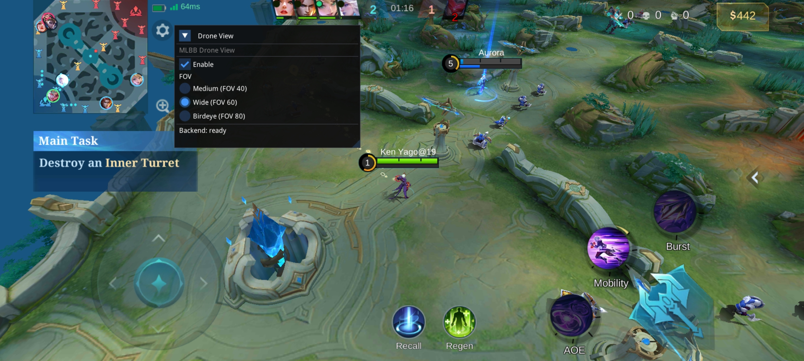

# MLBB Droneview Mod

<p align="center">
  
</p>

Single-purpose MLBB **Drone View** menu. No modular loader, no backends to
select, no extra features. One shared library, split into:

- **backend** — ELF/GlossHook, IL2CPP resolution, `eglSwapBuffers` and Unity
  input hooks, Drone View camera control.
- **frontend** — Dear ImGui 1.85 + OpenGL3 menu (Enable checkbox + FOV radio
  presets), touch handling.

## Layout

```text
droneview-menu/
├── include/droneview/backend.h      backend API
├── include/droneview/frontend.h     frontend API
├── src/backend/
│   ├── drone_backend.cpp            liblogic/libcsharp -> IL2CPP -> Camera
│   ├── overlay_hook.cpp             eglSwapBuffers hook
│   ├── input_hook.cpp               UnityPlayer.nativeInjectEvent hook
│   ├── runtime.cpp                  UI lifecycle
│   ├── entry.cpp                    .init_array autostart + dv_start/dv_stop
│   └── jni_onload.cpp               JNI_OnLoad autostart
├── src/frontend/menu.cpp            ImGui menu + touch
├── src/app/                         foundation borrowed from cpp_rebuild
├── dependencies/imgui/              Dear ImGui 1.85
├── dependencies/glosshook/          ARM64 prebuilt
└── dependencies/android-headers/
```

## Behavior

- The menu appears on the first frame after the library is loaded.
- `Enable` off → original camera FOV is restored.
- `Enable` on → `GameMethod.ShowCamera()` (if present) and
  `UnityEngine.Camera.set_fieldOfView(FOV)`, clamped to `20..120`.
- `FOV` radio presets: `Medium` = 40, `Wide` = 60, `Birdeye` = 80.
- Binding resolution runs on a worker thread; the render thread is never
  blocked. `liblogic.so` is the primary source, `libcsharp.so` fills missing
  symbols. The worker never `dlopen`s a library the game has not loaded.

## Build (Android arm64-v8a)

```bash
cd droneview-menu
./build-android.sh
```

Output:

```text
build-android/libcstatic.so
```

- ELF64 AArch64, Android 23, SONAME `libcstatic.so`
- statically linked libc++, **no `libc++_shared.so` dependency**

## How to Install

1. Download the latest Release APK from the [latest Release](https://github.com/anggorodhanumurti/droneview/releases/latest) page.
2. Extract and install the APK inside those zip files.
3. Clone MLBB and launch MLBB from inside Meta+ Evolution Space.

## Logs

Filter tag `droneview`:

```bash
adb logcat | grep -i droneview
```

Healthy sequence:

```text
droneview: background thread started
droneview: overlay hook installed: eglSwapBuffers @ ...
droneview: IL2CPP from liblogic.so: merged 19/19
droneview: ready: m_Camra=... show=... getFov=... setFov=...
droneview: UI initialized; Drone View menu active
droneview: input hook installed: nativeInjectEvent @ ...
droneview: drone enabled, original FOV ...
```

## Notes

- ARM64 only. A 32-bit Multispace plugin process will ignore
  `lib/arm64-v8a/`.
- The input hook slot (`libunity + 0x1888f60`) is validated before hooking; if
  it does not point inside `libunity`, input is skipped (menu still renders).
- If the game resets FOV every frame, the frame loop re-applies it.
